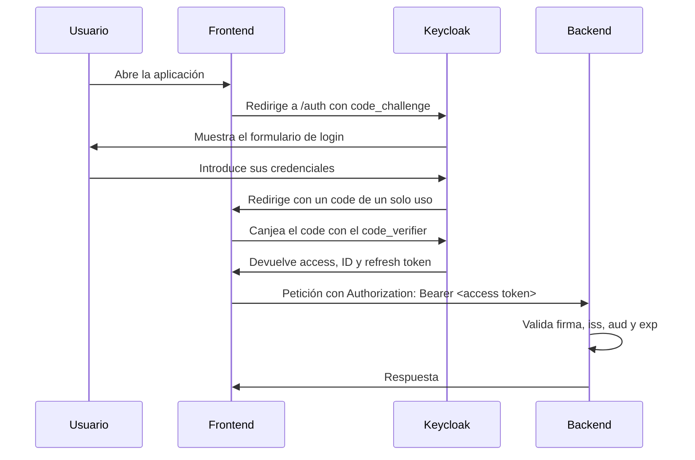

# Autenticación con Keycloak

Esta guía describe cómo Inbest delega la autenticación en Keycloak: qué papel
cumple cada componente, cómo está desplegado en local, qué configuración tiene
el realm `inbest` y por qué se eligió cada opción.

Versión documentada: Keycloak 26.8.2.

## Contenido

1. [Visión general](#1-visión-general)
2. [Conceptos](#2-conceptos)
3. [Flujo de autenticación](#3-flujo-de-autenticación)
4. [Despliegue local](#4-despliegue-local)
5. [Configuración del realm `inbest`](#5-configuración-del-realm-inbest)
6. [El token de acceso](#6-el-token-de-acceso)
7. [Integración con el backend](#7-integración-con-el-backend)
8. [Exportación e importación del realm](#8-exportación-e-importación-del-realm)
9. [Personalización de la interfaz](#9-personalización-de-la-interfaz)
10. [Verificación](#10-verificación)
11. [Solución de problemas](#11-solución-de-problemas)
12. [Consideraciones para producción](#12-consideraciones-para-producción)
13. [Referencias](#13-referencias)

## 1. Visión general

Keycloak es un servidor de identidad que implementa OpenID Connect (OIDC) y
OAuth 2.0. En Inbest se encarga de todo lo relacionado con la identidad del
usuario:

- registro, inicio y cierre de sesión;
- almacenamiento y hash de contraseñas;
- verificación de email y recuperación de contraseña;
- asignación de roles;
- emisión de los tokens que el resto del sistema usa para identificar al usuario.

El reparto de responsabilidades queda así:

| Componente | Responsabilidad |
|---|---|
| Keycloak | Autentica al usuario y emite tokens firmados |
| Frontend | Redirige al login de Keycloak, recibe los tokens y los envía al backend |
| Backend | Valida el token en cada petición y aplica las reglas de autorización |
| BD de Inbest | Guarda los datos de negocio del usuario, enlazados por `authentication_id` |

El backend no gestiona contraseñas ni sesiones. Solo comprueba que el token está
firmado por Keycloak, que no ha caducado y que va dirigido a la API.

## 2. Conceptos

**Realm.** Espacio aislado con sus propios usuarios, roles, clients y
configuración. Inbest usa el realm `inbest`. El realm `master` es exclusivo para
administrar Keycloak y no se usa para los usuarios de la aplicación.

**Client.** Aplicación que pide a Keycloak que autentique usuarios. Cada client
define qué flujos de autenticación puede usar y a qué URLs puede volver tras el
login.

**Client público y confidencial.** Un client confidencial tiene un secreto que
presenta ante Keycloak. Uno público no lo tiene, porque se ejecuta en un entorno
donde no se puede guardar un secreto, como un navegador. Los dos clients de Inbest
son públicos.

**Realm role.** Rol definido a nivel de realm, como `USER` o `ADMIN`. Se incluye
en el token, dentro del claim `realm_access.roles`.

**Default roles.** Roles que se asignan automáticamente a todo usuario nuevo. En
Keycloak se implementan como un rol compuesto llamado `default-roles-<realm>`.

**Client scope.** Conjunto reutilizable de claims y mappers que se añade a los
tokens de uno o varios clients. Si es de tipo *Default*, se incluye siempre; si es
*Optional*, solo cuando el client lo solicita.

**Protocol mapper.** Regla que añade o transforma un claim del token. Por
ejemplo, el *audience mapper* añade un valor al claim `aud`.

**User profile.** Esquema declarativo de los atributos del usuario. Define qué
atributos existen, cuáles son obligatorios y qué validaciones se aplican.

**Tokens.** Keycloak emite tres tipos de token:

| Token | Para qué sirve | Quién lo consume |
|---|---|---|
| Access token | Autorizar peticiones a la API | Backend |
| ID token | Informar al cliente de quién ha iniciado sesión | Frontend |
| Refresh token | Obtener un nuevo access token sin volver a pedir credenciales | Frontend, contra Keycloak |

**Issuer (`iss`).** URL del realm que firma el token. El backend lo usa para
descubrir las claves públicas y rechaza tokens de otros emisores.

**Audience (`aud`).** Destinatario del token. El backend solo acepta tokens cuyo
`aud` incluye `inbest-api`.

**Subject (`sub`).** Identificador estable y único del usuario dentro del realm.
No cambia aunque el usuario cambie su nombre de usuario o su email.

## 3. Flujo de autenticación

El frontend usa el flujo *Authorization Code* con PKCE, que es el recomendado
para aplicaciones que se ejecutan en el navegador.



**Por qué este flujo.** Las credenciales solo se introducen en Keycloak, nunca en
el frontend. PKCE impide que alguien que intercepte el `code` pueda canjearlo,
porque hace falta el `code_verifier`, que nunca sale del navegador del usuario.

**Por qué el backend es stateless.** Cada petición lleva su token, así que el
backend no necesita sesiones ni cookies. Como consecuencia, tampoco necesita
protección CSRF: un sitio malicioso no puede hacer que el navegador adjunte el
token automáticamente.

## 4. Despliegue local

Keycloak y su base de datos se definen en `compose.yaml`.

### 4.1. Arranque

```bash
docker compose up -d keycloak
```

Compose arranca también `keycloak-postgres`, porque es una dependencia de
`keycloak`. Para pararlos hay que nombrar los dos servicios:

```bash
docker compose stop keycloak keycloak-postgres
```

| URL | Uso |
|---|---|
| http://localhost:8081 | Consola de administración (usuario `admin`, contraseña `admin`) |
| http://localhost:8081/realms/inbest/account | Consola de cuenta de los usuarios |
| http://localhost:8081/realms/inbest/.well-known/openid-configuration | Metadatos OIDC del realm |
| http://localhost:8025 | Mailpit, donde llegan los emails que envía Keycloak |

### 4.2. Servicio `keycloak-postgres`

| Opción | Valor | Motivo |
|---|---|---|
| `image` | `postgres:18` | Keycloak necesita una BD persistente. Se usa una instancia separada para no mezclar sus tablas con las de Inbest |
| `volumes` | `keycloak-postgres-data` | Volumen gestionado por Docker. Los datos sobreviven aunque se borre el contenedor |
| `healthcheck` | `pg_isready -h 127.0.0.1 ...` | El `-h` fuerza la comprobación por TCP. Durante la inicialización, Postgres levanta un servidor temporal que solo escucha por socket; sin `-h`, el healthcheck podría darlo por listo antes de tiempo |
| `networks` | `keycloak` | Solo Keycloak puede conectarse a esta BD |
| `ports` | ninguno | La BD no es accesible desde el host |
| `labels` | `org.springframework.boot.ignore: "true"` | `spring-boot-docker-compose` crea una conexión JDBC por cada contenedor `postgres` que encuentra. La etiqueta evita que intente usar esta BD como datasource del backend |

### 4.3. Servicio `keycloak`

| Opción | Valor | Motivo |
|---|---|---|
| `image` | `quay.io/keycloak/keycloak:26.8.2` | Versión fija, para que un `docker pull` no cambie de versión sin avisar |
| `command` | `start-dev --import-realm` | `start-dev` arranca en modo desarrollo: permite HTTP y desactiva la caché de temas. `--import-realm` importa los JSON de `/opt/keycloak/data/import` al arrancar |
| `KC_DB`, `KC_DB_URL`, `KC_DB_USERNAME`, `KC_DB_PASSWORD` | `keycloak-postgres` | Conexión a su BD. El host es el nombre del servicio en Compose |
| `KC_HOSTNAME` | `http://localhost:8081` | Fija la URL pública. Determina el `iss` de los tokens, que el backend valida |
| `KC_BOOTSTRAP_ADMIN_USERNAME`, `KC_BOOTSTRAP_ADMIN_PASSWORD` | `admin` | Crean el administrador inicial del realm `master` en el primer arranque. Si ya existe un administrador, se ignoran |
| `KC_HEALTH_ENABLED` | `true` | Expone `/health` en el puerto de gestión 9000 |
| `KC_METRICS_ENABLED` | `true` | Expone `/metrics` en el puerto de gestión 9000 |
| `ports` | `127.0.0.1:8081:8080` | Publica Keycloak solo en el host local. Se usa el 8081 porque el backend ocupa el 8080 |
| `volumes` | `./keycloak:/opt/keycloak/data/import` | Carpeta del repositorio con el realm exportado. Ver [sección 8](#8-exportación-e-importación-del-realm) |
| `depends_on` | `condition: service_healthy` | Keycloak no arranca hasta que su BD supera el healthcheck |
| `networks` | `default` y `keycloak` | `keycloak` para llegar a su BD; `default` para publicar el puerto y llegar a Mailpit |

### 4.4. Red `keycloak`

La red se declara con `internal: true`. Los contenedores conectados solo a ella no
tienen salida a internet ni pueden publicar puertos. Así, `keycloak-postgres`
queda aislada del resto de servicios de Compose y del exterior.

El backend se ejecuta en el host, no en un contenedor, así que no pertenece a
ninguna red de Docker. Accede a Keycloak a través del puerto publicado
`localhost:8081`.

## 5. Configuración del realm `inbest`

Esta sección recoge la configuración del realm tal como está en
`keycloak/inbest-realm.json`. Las rutas indican dónde encontrar cada opción en la
consola de administración.

### 5.1. Login

*Realm settings → Login*

| Opción | Valor | Motivo |
|---|---|---|
| User registration | ON | Los usuarios pueden crear su propia cuenta |
| Forgot password | ON | Los usuarios pueden restablecer su contraseña por email |
| Verify email | ON | El usuario debe confirmar su email antes de poder usar la cuenta. Garantiza que el email que llega al backend pertenece al usuario |
| Login with email | ON | Se puede iniciar sesión con el nombre de usuario o con el email |
| Email as username | OFF | Inbest guarda un `username` propio, distinto del email |

### 5.2. Email

*Realm settings → Email*

| Opción | Valor | Motivo |
|---|---|---|
| From | `no-reply@inbest.local` | Remitente de los emails de verificación y recuperación |
| Host | `mailpit` | Nombre del servicio de Mailpit en Compose |
| Port | `1025` | Puerto SMTP de Mailpit |
| SSL, StartTLS, autenticación | OFF | Mailpit es un buzón local de desarrollo y no los necesita |

Sin un servidor SMTP configurado, el registro falla al intentar enviar el email
de verificación.

### 5.3. User profile

*Realm settings → User profile*

| Atributo | Obligatorio | Validación | Motivo |
|---|---|---|---|
| `username` | Siempre | Longitud de 3 a 30 | Coincide con `users.username VARCHAR(30)` |
| `email` | Para usuarios y administradores | Formato de email, máximo 255 | `users.email` es `NOT NULL`. Si un administrador pudiera crear usuarios sin email, el alta en la BD de Inbest fallaría |
| `firstName` | No | Máximo 255 | Coincide con `users.first_name VARCHAR(255)`, que admite `NULL` |
| `lastName` | No | Máximo 255 | Coincide con `users.last_name VARCHAR(255)`, que admite `NULL` |

Los límites del perfil de usuario deben coincidir con los de la BD. Si Keycloak
acepta un valor que la BD rechaza, el usuario puede iniciar sesión pero el
backend no puede darlo de alta.

Keycloak guarda el nombre de usuario y el email en minúsculas, lo que satisface la
restricción `ck_users_email_normalized` de la BD.

### 5.4. Roles

*Realm roles*

| Rol | Uso |
|---|---|
| `USER` | Usuario estándar de la aplicación |
| `ADMIN` | Acceso a las operaciones de administración |

Los nombres van en mayúsculas porque el backend les antepone `ROLE_` y Spring
Security los compara con `hasRole("ADMIN")`.

*Realm settings → User registration → Default roles*

`default-roles-inbest` incluye `USER`. Todo usuario nuevo, tanto si se registra él
mismo como si lo crea un administrador, recibe `USER` sin intervención manual.
Este cambio solo afecta a los usuarios creados después de configurarlo.

`default-roles-inbest` también incluye `offline_access`, `uma_authorization` y los
roles del client `account`. Son los valores por defecto de Keycloak y permiten al
usuario gestionar su cuenta desde la consola de cuenta.

### 5.5. Client scope `inbest-api`

*Client scopes → inbest-api*

| Opción | Valor | Motivo |
|---|---|---|
| Type | Default | Se añade automáticamente a todos los clients del realm |
| Include in token scope | ON | Aparece en el claim `scope` del token |

**Mapper `inbest-api audience`** (tipo *Audience*):

| Opción | Valor | Motivo |
|---|---|---|
| Included Custom Audience | `inbest-api` | Valor que se añade al claim `aud` |
| Add to access token | ON | El backend valida el `aud` del access token |
| Add to ID token | OFF | El ID token es para el frontend, no para la API |

**Por qué es necesario.** Por defecto, el `aud` de un access token de Keycloak
contiene `account`, no la API. Al validar la audiencia, el backend rechaza tokens
emitidos para otros fines aunque estén firmados por el mismo realm.

### 5.6. Client `inbest-frontend`

*Clients → inbest-frontend*

Client que usará la SPA del frontend.

| Opción | Valor | Motivo |
|---|---|---|
| Client authentication | OFF | Client público: el código se ejecuta en el navegador y no puede guardar un secreto |
| Standard flow | ON | Habilita el flujo *Authorization Code* |
| Direct access grants | OFF | La SPA nunca recibe las credenciales del usuario |
| PKCE Method | `S256` | Obligatorio en clients públicos para proteger el canje del `code` |
| Valid redirect URIs | `http://localhost:5173/*` | Keycloak solo redirige a estas URLs tras el login. Evita que un atacante robe el `code` redirigiéndolo a su dominio |
| Valid post logout redirect URIs | `http://localhost:5173/*` | URLs permitidas tras cerrar sesión |
| Web origins | `http://localhost:5173` | Orígenes a los que Keycloak permite peticiones CORS, necesarias para canjear el `code` desde el navegador |

`5173` es el puerto por defecto de Vite. Si el frontend usa otro puerto, hay que
actualizar estas tres opciones.

### 5.7. Client `inbest-dev`

*Clients → inbest-dev*

Client exclusivo para desarrollo. Permite obtener tokens desde la línea de
comandos sin pasar por el navegador.

| Opción | Valor | Motivo |
|---|---|---|
| Client authentication | OFF | Client público, sin secreto |
| Standard flow | OFF | No se usa desde el navegador |
| Direct access grants | ON | Permite el flujo *Resource Owner Password Credentials*: se envían usuario y contraseña directamente a Keycloak |

El flujo *Direct access grants* está desaconsejado en OAuth 2.1, porque obliga a
que el cliente maneje la contraseña del usuario. Este client no debe existir en
producción.

### 5.8. Sesiones y tokens

Se mantienen los valores por defecto de Keycloak:

| Opción | Valor | Significado |
|---|---|---|
| Access Token Lifespan | 5 minutos | Duración del access token. Un valor corto limita el daño si se filtra |
| SSO Session Idle | 30 minutos | La sesión caduca tras 30 minutos sin actividad |
| SSO Session Max | 10 horas | Duración máxima de una sesión, aunque haya actividad |
| Require SSL | `external` | Exige HTTPS salvo en peticiones desde `localhost` o redes privadas |

El frontend debe renovar el access token con el refresh token antes de que
caduque. Las librerías `keycloak-js` y `oidc-client-ts` lo hacen automáticamente.

### 5.9. Usuarios de prueba

| Usuario | Email | Roles |
|---|---|---|
| `bob` | `bob@inbest.local` | `USER` (por defecto) y `ADMIN` |
| `test` | `test@inbest.local` | `USER` (por defecto) |

Ambos tienen el email verificado y contraseña no temporal. Para restablecer una
contraseña: *Users → (usuario) → Credentials → Reset password*, con *Temporary*
en OFF.

## 6. El token de acceso

Un access token del realm contiene, entre otros, estos claims:

```json
{
  "iss": "http://localhost:8081/realms/inbest",
  "aud": ["inbest-api", "account"],
  "sub": "9f3c1a2e-...",
  "typ": "Bearer",
  "azp": "inbest-frontend",
  "preferred_username": "test",
  "email": "test@inbest.local",
  "email_verified": true,
  "given_name": "FirstName",
  "family_name": "...",
  "realm_access": {
    "roles": ["USER", "offline_access", "uma_authorization", "default-roles-inbest"]
  },
  "exp": 1762790000,
  "iat": 1762789700
}
```

Correspondencia con la tabla `users`:

| Claim | Columna | Notas |
|---|---|---|
| `sub` | `authentication_id` | Clave que enlaza ambos sistemas. Nunca cambia |
| `preferred_username` | `username` | |
| `email` | `email` | |
| `given_name` | `first_name` | Puede no venir si el usuario no lo ha rellenado |
| `family_name` | `last_name` | Puede no venir si el usuario no lo ha rellenado |
| `realm_access.roles` | — | No se guarda. Se lee del token en cada petición |

Las FKs del resto de tablas apuntan a `users.id`, no a `sub`. El identificador de
Keycloak solo se usa para localizar al usuario local.

## 7. Integración con el backend

> **Estado:** pendiente de implementar. Esta sección describe el diseño acordado.

### 7.1. Resource server

El backend actúa como *OAuth 2.0 Resource Server* con la dependencia:

```groovy
implementation 'org.springframework.boot:spring-boot-starter-security-oauth2-resource-server'
```

Y la configuración:

```properties
spring.security.oauth2.resourceserver.jwt.issuer-uri=http://localhost:8081/realms/inbest
spring.security.oauth2.resourceserver.jwt.audiences=inbest-api
```

Con `issuer-uri`, Spring descarga los metadatos del realm en la primera petición
autenticada, obtiene las claves públicas y valida en cada token:

- la firma;
- que `iss` coincide con `issuer-uri`;
- que `aud` incluye `inbest-api`;
- que el token no ha caducado (`exp`) ni se usa antes de tiempo (`nbf`).

El backend no necesita contactar con Keycloak en cada petición: las claves se
guardan en caché.

### 7.2. Roles

Keycloak guarda los roles en `realm_access.roles`, un claim anidado que Spring
no lee por defecto. Un `JwtAuthenticationConverter` personalizado los convierte en
autoridades `ROLE_USER` y `ROLE_ADMIN`, que se usan con `hasRole(...)`.

El rol no se copia a la tabla `users` (la columna se eliminó en `V7`). Una copia
local quedaría desactualizada hasta la siguiente petición del usuario si un
administrador cambia sus roles en Keycloak, y podría acabar usándose para
autorizar por error. El token es la única fuente del rol.

### 7.3. Alta del usuario local

En la primera petición autenticada de un usuario, el backend busca su `sub` en
`users.authentication_id`. Si no existe, crea el registro con los datos del
token. Si existe, actualiza el nombre de usuario, el email, el nombre y los apellidos
cuando difieren de los del token, para que la copia local no quede desactualizada.

## 8. Exportación e importación del realm

La configuración del realm se guarda en `keycloak/inbest-realm.json`, dentro del
repositorio, para que cualquier miembro del equipo obtenga el mismo realm.

### 8.1. Importación

Con `--import-realm`, Keycloak lee al arrancar los JSON de
`/opt/keycloak/data/import`, que corresponde a la carpeta `keycloak/` del
repositorio.

- Si el realm no existe, lo crea.
- Si el realm ya existe, no hace nada. **Los cambios en el JSON no se aplican a un
  realm que ya existe.**

Para forzar la importación desde cero hay que borrar la BD de Keycloak:

```bash
docker compose rm -sf keycloak keycloak-postgres
```

```bash
docker volume rm inbest_keycloak-postgres-data
```

```bash
docker compose up -d keycloak
```

### 8.2. Exportación

Después de cambiar la configuración desde la consola, hay que exportar el realm y
hacer commit del JSON:

```bash
docker compose run --rm keycloak export --realm inbest --dir /opt/keycloak/data/import --users realm_file
```

Se usa `run` en lugar de `exec` porque la exportación arranca otra instancia de
Keycloak. Dentro del contenedor en ejecución chocaría con el puerto de gestión
9000, que ya está en uso. `run` crea un contenedor temporal con la misma
configuración, sin publicar puertos, y lo elimina al terminar.

`--users realm_file` incluye los usuarios en el mismo fichero, con sus
contraseñas hasheadas. El fichero solo debe contener usuarios de prueba.

## 9. Personalización de la interfaz

Con el flujo *Authorization Code*, los usuarios ven las páginas de Keycloak al
iniciar sesión, registrarse, verificar el email y recuperar la contraseña. No
acceden nunca a la consola de administración.

### 9.1. Temas

Keycloak separa su interfaz en tipos de tema, que se asignan por realm en
*Realm settings → Themes*:

| Tipo | Páginas |
|---|---|
| `login` | Login, registro, recuperación de contraseña, verificación de email |
| `account` | Consola de cuenta del usuario |
| `email` | Plantillas de los emails |
| `admin` | Consola de administración |

Un tema propio puede heredar de uno existente y sobrescribir solo lo necesario:
hojas de estilo, imágenes, textos o plantillas FreeMarker (`.ftl`). Se monta en
`/opt/keycloak/themes/<nombre>`:

```
keycloak/themes/inbest/
├── login/
│   ├── theme.properties
│   ├── resources/css/inbest.css
│   └── messages/messages_es.properties
└── email/
    └── ...
```

```properties
# keycloak/themes/inbest/login/theme.properties
parent=keycloak.v2
```

`parent` hace que el tema herede todo lo que no sobrescribe. Para añadir una hoja
de estilos propia, la propiedad `styles` debe listar las hojas del tema padre
seguidas de la nueva, porque `styles` reemplaza la lista heredada en lugar de
ampliarla.

```yaml
# compose.yaml, servicio keycloak
volumes:
  - ./keycloak:/opt/keycloak/data/import
  - ./keycloak/themes:/opt/keycloak/themes
```

En modo `start-dev` la caché de temas está desactivada, así que los cambios se
ven al recargar la página.

Con este montaje, la carpeta de temas también queda visible dentro del directorio
de importación, porque está dentro de `./keycloak`. Si se añaden temas, conviene
mover el realm a `keycloak/import/` y montar esa carpeta en
`/opt/keycloak/data/import`, de modo que cada montaje contenga solo lo que
necesita.

### 9.2. Keycloakify

[Keycloakify](https://www.keycloakify.dev) permite escribir las páginas de login y
de cuenta como componentes React y empaquetarlas como un tema de Keycloak. Es la
opción más cómoda si el frontend usa React y se quiere reutilizar su diseño.

### 9.3. Idioma

*Realm settings → Localization*: activar *Internationalization* y añadir
`es` a los idiomas soportados. Keycloak incluye traducciones al español de todas
sus páginas.

### 9.4. Alternativa desaconsejada

Construir los formularios de login en el frontend y enviar las credenciales con
*Direct access grants* evita las páginas de Keycloak, pero:

- la contraseña pasa por el frontend;
- se pierden la autenticación en dos pasos, el login con proveedores externos y
  las protecciones de Keycloak contra ataques de fuerza bruta;
- el flujo está desaconsejado en OAuth 2.1.

La práctica recomendada es mantener las páginas de Keycloak y adaptarlas con un
tema.

## 10. Verificación

Obtener un access token:

```bash
TOKEN=$(curl -s http://localhost:8081/realms/inbest/protocol/openid-connect/token -d grant_type=password -d client_id=inbest-dev -d username=test -d password=<contraseña> | jq -r .access_token)
```

Decodificar su contenido:

```bash
echo "$TOKEN" | jq -R 'split(".")[1] | gsub("-";"+") | gsub("_";"/") | @base64d | fromjson | {iss, aud, sub, preferred_username, email, realm_access}'
```

El resultado debe cumplir:

- `iss` es `http://localhost:8081/realms/inbest`;
- `aud` incluye `inbest-api`;
- `realm_access.roles` incluye `USER`.

Los JWT usan base64url sin relleno. `base64 -d` de macOS corta el final del JSON
en esos casos, por eso se decodifica con `jq`.

## 11. Solución de problemas

| Síntoma | Causa probable | Solución |
|---|---|---|
| `Invalid user credentials` | Usuario o contraseña incorrectos | Restablecer la contraseña desde la consola |
| `Account is not fully set up` | Contraseña temporal, acción requerida pendiente o atributo obligatorio vacío | Revisar *Credentials*, *Required user actions* y los atributos del usuario |
| `unauthorized_client` | El client no tiene *Direct access grants* | Usar `inbest-dev` |
| `aud` no incluye `inbest-api` | El client scope no está asignado al client | *Clients → (client) → Client scopes*: añadir `inbest-api` como *Default* |
| Falta `USER` en `realm_access.roles` | Usuario creado antes de añadir `USER` a los default roles | Asignar el rol en *Users → Role mapping* |
| El registro falla al enviar el email | SMTP sin configurar o Mailpit parado | Revisar *Realm settings → Email* y que Mailpit esté levantado |
| El backend devuelve 401 con un token válido | `iss` distinto de `issuer-uri` | Comprobar que `KC_HOSTNAME` y `issuer-uri` usan la misma URL |
| Error CORS desde el frontend | Origen no registrado | Revisar *Web origins* de `inbest-frontend` |
| Los cambios del JSON no se aplican | El realm ya existía al arrancar | Ver [sección 8.1](#81-importación) |

## 12. Consideraciones para producción

La configuración actual está pensada para desarrollo local. En producción:

- Arrancar con `start` en lugar de `start-dev`, con una imagen optimizada.
- Servir Keycloak por HTTPS y ajustar `KC_HOSTNAME` a la URL pública real.
- Pasar las credenciales de la BD y del administrador como secretos, no en
  `compose.yaml`.
- Crear un administrador permanente y eliminar el temporal creado con las
  variables `KC_BOOTSTRAP_ADMIN_*`.
- Eliminar el client `inbest-dev`.
- Activar *Brute force detection* en *Realm settings → Security defenses*.
- Configurar un servidor SMTP real.
- Actualizar las URLs de `inbest-frontend` con el dominio de producción.
- No importar usuarios de prueba: exportar el realm sin `--users`.
- Hacer copias de seguridad de la BD de Keycloak.

## 13. Referencias

- [Documentación de Keycloak](https://www.keycloak.org/documentation)
- [Server Administration Guide](https://www.keycloak.org/docs/latest/server_admin/)
- [Configuring Keycloak for production](https://www.keycloak.org/server/configuration-production)
- [Importing and exporting realms](https://www.keycloak.org/server/importExport)
- [Themes](https://www.keycloak.org/ui-customization/themes)
- [Spring Security: OAuth 2.0 Resource Server JWT](https://docs.spring.io/spring-security/reference/servlet/oauth2/resource-server/jwt.html)
- [RFC 7636: PKCE](https://datatracker.ietf.org/doc/html/rfc7636)
